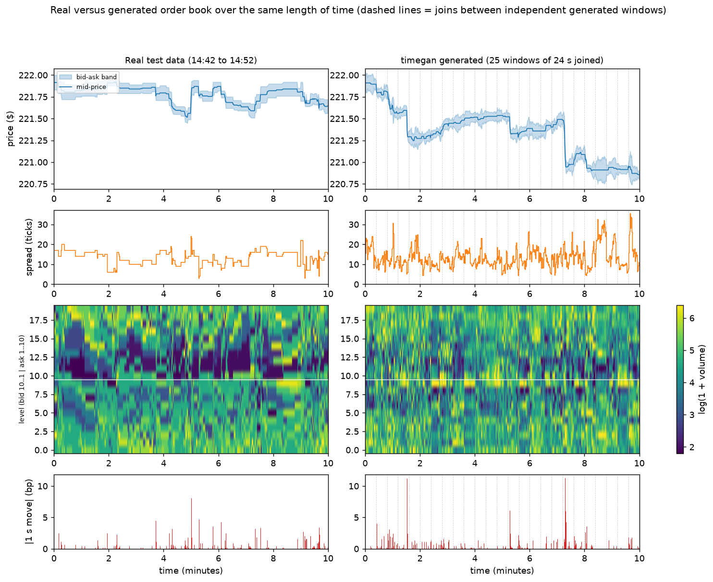
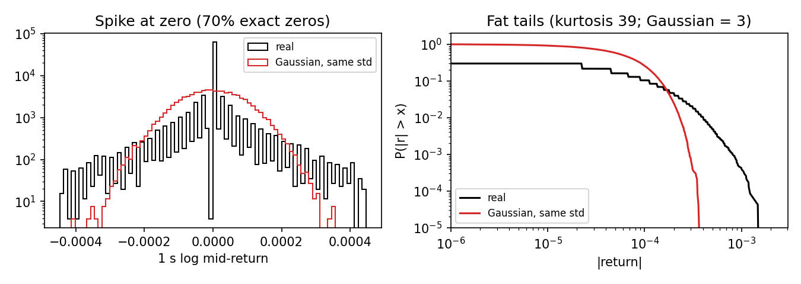
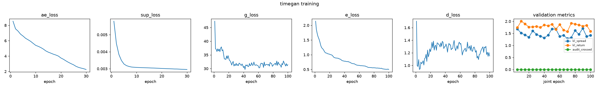
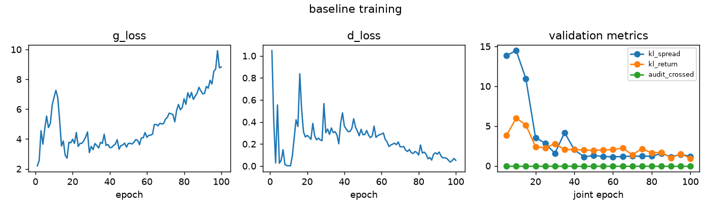
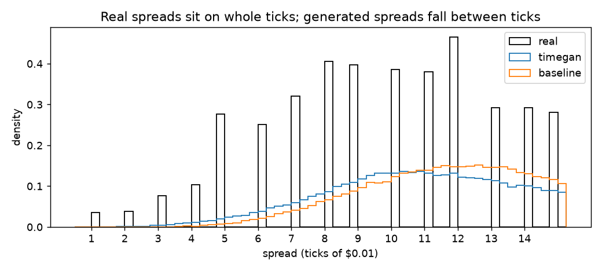
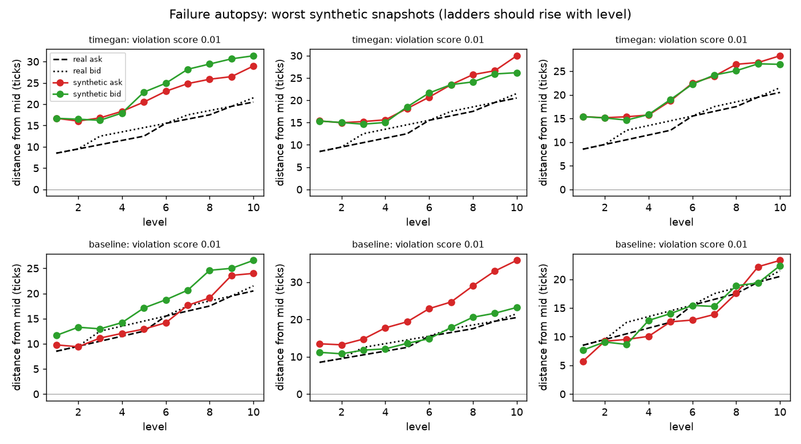
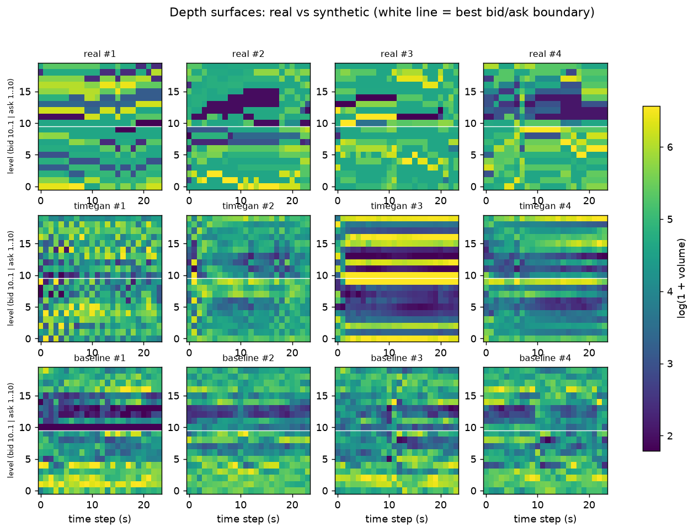
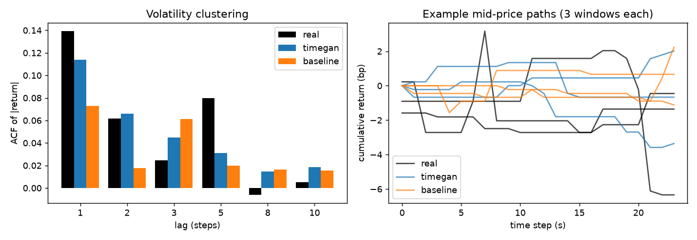

# TimeGAN Market Data Generation

TimeGAN for limit order book simulation (LOBSTER AMZN, Level 10).

Project 2.7 (Time-Series Generation: Limit Order Book and Market Simulation), Hard difficulty.

Author: Jamie Landolt (s4883946)

## Overview

**Problem.** Real microsecond limit order book (LOB) data is commercially restricted and expensive, yet it is what strategies, trading algorithms and risk systems are evaluated on. Synthetic data can stand in for it, but generating it is non-trivial: an order book is not an ordinary time series, and the generated data must keep the invariants and patterns of the real market. The best bid must be below the best ask ($P_{bid,1} < P_{ask,1}$, otherwise the book is *crossed*, a free arbitrage), prices must be monotonic across the 10 depth levels, liquidity depth cannot be negative, and the sequence should show stylised facts such as volatility clustering and heavy-tailed returns. This project trains a **TimeGAN** on one day of AMZN Level-10 data from LOBSTER and audits whether the generated 24-second order book windows respect those rules and match the real distributions, compared with a plain recurrent GAN baseline.

**How it works.** Each real window is a 24-step sequence (one step per second) of 41 features: the mid-price log-return, the distance of each of 10 ask and 10 bid levels from the mid-price, and the volume at each of those 20 levels. TimeGAN (Yoon, Jarrett and van der Schaar, NeurIPS 2019) combines the two-network architecture of an autoencoder (embedder and recovery) with a GAN, modified by a third supervisor network, and works in a *latent space*. The embedder and recovery networks map windows to and from latent sequences, a generator turns random noise into latent sequences, the supervisor learns their step-to-step dynamics, and a discriminator tells real latents from generated ones. Training has three phases (autoencoder, supervisor, then everything jointly) using reconstruction, supervised, adversarial and mean/std-matching losses. After training, noise is sampled, run through the generator and tweaked by the supervisor, then decoded back to prices and volumes. TimeGAN can learn to produce similar patterns and respect the market invariants, and this project measures how well it does so: generated windows are audited for crossed books, invalid price ladders and negative depth, then compared with real held-out windows using KL divergence, SSIM of depth heatmaps and volatility clustering. The baseline is a GRU generator and discriminator working directly on the features with only the adversarial loss.

```
real window x --Embedder--> h --Recovery--> x~          (reconstruction loss)
                            |
                            +--Supervisor--> next-step prediction of h  (supervised loss)

noise z --Generator--> e^ --Supervisor--> h^ --Recovery--> x^   (synthetic window)

Discriminator: real latents h   vs   generated latents h^, e^    (adversarial loss)
```

**Example output.** Ten minutes of real test-period order book (left) next to the same length of TimeGAN output (right). From top to bottom: mid-price with the best bid and ask, spread in ticks, depth heatmap (bid levels 10 to 1, then ask levels 1 to 10) and the size of each one-second price move. The generated side is 25 independent 24-second windows joined end to end (dashed lines mark the joins), so it has no memory across a join. The model matches the size and rhythm of the price moves and the range of the spread. It does not match the real book's persistence: its spread changes every second, its depth is fine-grained rather than blocky, and its prices are off the tick grid (see the failure case autopsy). Produced by `plot_comparison.py` with the final TimeGAN.



## Files

| File | Purpose |
|---|---|
| `modules.py` | TimeGAN networks and the recurrent-GAN baseline (PyTorch only) |
| `dataset.py` | Loading, 1-second resampling, features, return transforms, chronological split, windows, data loaders |
| `train.py` | Training, validation, test and checkpointing for both models; loss curves |
| `predict.py` | Loads trained weights, samples windows, compares with real data, saves figures |
| `metrics.py` | Microstructure audit, KL divergence, volatility clustering, depth-heatmap SSIM |
| `test_pipeline.py` | Unit and end-to-end tests (use a small fake order book, no real data needed) |
| `audit_data.py`, `plot_returns.py` | Real-data audit and return-distribution figure |
| `analyse_failures.py` | Failure analysis: tick grid, ladder violation size, negative depth |
| `slurm_train.sh`, `slurm_pack.sh`, `run_experiments.sh`, `summarise_runs.py` | Running and summarising experiments on the Rangpur cluster |

## Dependencies and reproducibility

Results were produced on the Rangpur cluster (NVIDIA A100 GPUs) with these exact versions:

| Package | Version |
|---|---|
| Python | 3.11.15 |
| PyTorch | 2.13.0+cu130 |
| NumPy | 2.4.6 |
| SciPy | 1.17.1 |
| Matplotlib | 3.11.1 |
| scikit-image | 0.26.0 |

`modules.py` depends only on PyTorch. The LOBSTER sample files are **not** committed (assessment rule); place the two CSV files and the LOBSTER readme in one directory and pass it with `--data-dir`. Every run takes `--seed`; the reported numbers are the mean and standard deviation over seeds 0, 1 and 2. GPU training is not bit-for-bit deterministic, so single runs can differ slightly.

## Usage

The code is on the `topic-recognition` branch, so after cloning the repository switch to it and move into the project folder:

```bash
git checkout topic-recognition
cd recognition/TimeGAN_s4883946
pip install torch numpy scipy matplotlib scikit-image   # versions in the table above
```

`<data_dir>` below is the folder holding the LOBSTER files `AMZN_2012-06-21_34200000_57600000_orderbook_10.csv` and `AMZN_2012-06-21_34200000_57600000_message_10.csv` (the data is not committed, so supply your own copy). Training, `predict.py` and `plot_comparison.py` also need trained model files, which are not committed either, so train first with the commands below.

```bash
# unit and end-to-end tests (no real data needed)
python -m unittest test_pipeline -v

# audit of the real data, and the return-distribution figure
python audit_data.py <data_dir>
python plot_returns.py <data_dir> figures/return_distribution.png

# train (outputs/<model>.pt, <model>_summary.json, <model>_training.png)
python train.py --model timegan  --data-dir <data_dir> --out-dir outputs
python train.py --model baseline --data-dir <data_dir> --out-dir outputs
# optional TimeGAN changes studied below:
#   --return-transform quantile --ladder increments --feature-adv --w-diff 10 --step 1

# sample from the trained models, print the comparison table and save figures
python predict.py --data-dir <data_dir> --model-dir outputs

# ten minutes of real test data next to generated data (the example-output figure)
python plot_comparison.py --data-dir <data_dir> --model-dir outputs --model timegan \
    --minutes 10 --out figures/real_vs_timegan_window.png

# on Rangpur (Slurm): one run, or a whole experiment group
sbatch --job-name=lob_timegan slurm_train.sh timegan
./run_experiments.sh transform        # also: step, loss, depth, ladder, combined
python summarise_runs.py outputs/transform
```

## Feasibility Review

**Audience:** project manager (tutor). **Question under review:** can a TimeGAN produce synthetic order books that are safe to use for backtesting, i.e. that respect hard microstructure invariants and not just look plausible?

### 1. User need, scope and acceptance criteria

The intended user is a quant developer who needs realistic order-book simulations to stress-test execution strategies without paying for tick-data licences. The prototype generates windows of 10-level order book snapshots and audits them against microstructure rules. Acceptance criteria (all measured on a held-out, chronologically later test period, against the baseline on the same split):

1. **Structural validity:** crossed or locked books (P_bid,1 >= P_ask,1) in generated data are reported as a rate per 1,000 snapshots, with the real data's rate (0, see below) as the reference. Target: 0 for the final model; the baseline's rate is reported for comparison.
2. **Distributional fidelity:** KL divergence between real and synthetic distributions of spread and of mid-price returns <= 0.1 (spec target). Real data from the training period already scores about 0.2 against the test period (section 3), so the achievable floor is reported next to every result.
3. **Depth structure:** SSIM > 0.6 between real and synthetic depth heatmaps (price level x time step) (spec target). Held-out real windows only reach about 0.28 against their nearest real window, so results are reported against that ceiling as well as against the target.
4. **Stylised facts:** the autocorrelation of absolute returns inside 24-step windows at lags 1, 5 and 10 is positive and decays as in the real test data (0.14 / 0.08 / 0.005), rather than collapsing to roughly 0 (white noise) or being far too persistent.
5. **Resource constraint:** peak GPU memory <= 2 GB and training time <= 30 minutes per model on one GPU (first full runs measured 0.57 GB and 9 minutes for TimeGAN).

### 2. Model choice and course concepts

- **Dataset:** LOBSTER sample, AMZN, 2012-06-21, 09:30 to 16:00, 10 levels, 269,748 events. Prices are in units of 1/10,000 dollar.
- **Model:** TimeGAN (Yoon, Jarrett and van der Schaar, NeurIPS 2019): an embedding/recovery autoencoder, a supervised next-step loss in latent space, and an adversarial loss, which together are meant to capture temporal dynamics better than a plain GAN. **Difficulty band:** Hard.
- **Baseline:** a vanilla recurrent GAN (GRU generator and discriminator) with only the adversarial loss, so the comparison isolates what TimeGAN's supervised and reconstruction losses add.
- **Preprocessing:** log-returns for prices, volume normalisation, resampling onto a fixed time grid, and a chronological train/validation/test split (no shuffling across time, to avoid look-ahead bias).
- **Course concepts:** GAN training and its instabilities (mode collapse, balancing generator and discriminator), recurrent sequence models, and autoencoders. Literature support is the TimeGAN paper above and the LOBSTER data description (Huang and Polak, 2011).

### 3. Preliminary feasibility evidence (data audit)

`audit_data.py` was run on the real sample on Rangpur. Findings:

| Check | Result |
|---|---|
| Crossed or locked books | 0 of 269,748 |
| Non-monotonic bid or ask ladders | 0 |
| Negative or zero depth | 0 |
| Spread | $0.01 to $0.77 (median $0.13) |
| Zero mid-price change per event / per 1 s grid step | 89.8% / 70.1% |
| Return kurtosis per event / per 1 s grid step | about 203 / 38.5 (Gaussian = 3) |
| Autocorrelation of absolute returns, per event (lags 1 / 5 / 20) | 0.25 / 0.15 / 0.10 |



Implications: (a) the real data is clean, so any invariant violation in synthetic data is attributable to the model; (b) volatility clustering is present and can be tested; (c) returns have a sharp spike at zero and very fat tails (figure), so I model a 1-second grid rather than raw events; (d) volumes are heavily skewed (median 100, max 5,700 shares), so they use log scaling.

**Early results from the pipeline and first full runs** (one seed, trained on Rangpur): TimeGAN has 480k parameters, trained in about 9 minutes with 0.57 GB peak GPU memory; the baseline GAN took about 2 minutes. Neither generator produced a crossed book, but the baseline broke the price-ladder ordering in 98.6% of snapshots against 14.6% for TimeGAN, so the central question is measurable. Neither is close to the distribution targets (KL about 1.3 for spread and returns, against about 0.2 for real train-vs-test data). Real windows reach only about 0.28 SSIM against their nearest real neighbour, so a perfect generator would not reach the 0.6 target under this definition.

### 4. Risks, budget and fallback

| Risk | Mitigation |
|---|---|
| The sample is a single trading day, so the "later hours" test set is small and the result may not generalise across days | State this limitation explicitly; use a chronological split and report uncertainty rather than claiming general market validity |
| Return KL <= 0.1 may be very hard: real returns have a sharp spike at zero (70% zeros) and fat tails (kurtosis 38.5), while a generator fed Gaussian noise and trained with MSE and moment-matching losses tends towards a smooth bell-shaped hump, which the first run is consistent with (hypothesis, not yet tested). z-scoring with a few extreme outliers may also let those outliers dominate the losses. KL is also noisy in the sparse tails and depends on binning | Fix the binning rule up front and report it; run a normalisation ablation (plain z-score vs clipped vs quantile transform, and modelling exact zeros separately) and compare each against the real train-vs-test KL floor of about 0.2 |
| The spec's KL <= 0.1 and SSIM > 0.6 targets may be unattainable on a single day of data (real train-vs-test KL about 0.2; real-vs-nearest-real SSIM about 0.28) | Report every result next to these real-data references, so it is clear how much of any gap comes from the single-day data and how much from the model |
| TimeGAN training instability or mode collapse | Train the baseline first, monitor losses and sample diversity, tune the learning rate and the balance of the three losses |
| Raw TimeGAN outputs are unconstrained and may cross the book | Report violation rates on raw outputs as the main result; any decoding constraint (for example enforcing positive spread by construction) is reported separately, because it would not show the model learning the invariant |
| Rangpur GPU queue time | Short smoke-test jobs first, then one longer batch job |

**Budget:** one GPU on the `comp3710` partition via Slurm. A full TimeGAN run takes about 9 minutes, so there is room for repeated runs and several seeds.
**Next experiment:** the normalisation ablation above, measured on the same chronological validation and test splits, plus repeat runs with different seeds so differences between models are not single-run noise.
**Fallback:** if TimeGAN will not train stably, report the baseline plus a TimeGAN with a simplified architecture and shorter windows, and document the failure modes honestly, since the project question is whether the model enforces the invariants and not only whether it succeeds.

## Data and preprocessing

**Data.** LOBSTER sample file for AMZN on 2012-06-21, 09:30 to 16:00, 10 price levels: 269,748 order book events (Huang and Polak, 2011). Prices are stored in units of 1/10,000 dollar, and the minimum price step (tick) is $0.01.

**Preprocessing** (all in `dataset.py`):

1. **Resample onto a 1-second grid.** Events arrive at irregular times and about 90% of them leave the mid-price unchanged. For each second, the book is the state after the last event at or before that time. This gives 23,400 evenly spaced snapshots; 70% of 1-second mid-returns are still exactly zero (event level: 90%), and the kurtosis falls from about 203 to 38.5.
2. **Features (41 per step).** The mid-price log-return `ln(P_t / P_{t-1})`; the distance of each of the 10 ask and 10 bid levels from the mid-price in ticks, as `log1p(distance)`; and `log1p(volume)` for each of the 20 levels (volumes are very skewed: median 100, maximum 5,700 shares). Expressing prices as distances from the mid-price turns the market rules into sign and ordering conditions that can be audited, instead of building them into the representation.
3. **Optional return transform** (`--return-transform`): plain z-scoring, winsorising at the 0.5th and 99.5th percentiles (`clip`), or a quantile transform (`quantile`) that maps returns to normal scores through the training-set empirical CDF. In the quantile transform all exact zeros map to one value and decoding sends a whole band of normal scores back to exactly 0, so the generator does not have to output exact zeros.
4. **Optional ladder representation** (`--ladder`): either the distance of every level from the mid-price (`levels`), or the distance of level 1 followed by the gap between successive levels (`increments`). Real gaps are always at least one tick, so with `increments` the model only has to produce positive gaps for the ladder to stay ordered. Nothing is enforced: a negative decoded gap is counted as a violation.
5. **Chronological split, then normalisation.** Each feature is z-scored with the mean and standard deviation of the **training split only**.
6. **Windows.** Overlapping 24-step windows (stride 1), built inside each split.

**Splits and why.** The day is split in time order, with no shuffling: the first 60% for training (09:30 to 13:24), the next 20% for validation (13:24 to 14:42) and the last 20% for testing (14:42 to 16:00). Models only see earlier data than they are validated and tested on, which prevents look-ahead bias. Windows never cross a split boundary, and normalisation statistics and the quantile transform are fitted on the training split only, so nothing leaks. This gives 14,017 training, 4,657 validation and 4,657 test windows. Model selection (the best checkpoint) uses the validation split; the test split is only used for the reported numbers. Because the sample is a single day, the test period is a different part of the same day and not a different day, so results should not be read as evidence about other days or market conditions.


*Real 1-second mid-returns have a sharp spike at zero (70% exact zeros) and far heavier tails than a Gaussian of the same standard deviation (kurtosis 38.5 against 3).*

## Evaluation

All metrics compare generated windows with **real test windows** (`metrics.py`).

- **Microstructure audit** (per snapshot): *crossed* (best ask not above best bid, i.e. spread <= 0), *ladder* (ask prices not rising, or bid prices not falling, with depth level), *negative depth*.
- **KL divergence** between real and generated spread, and between real and generated 1-step mid-returns. Binning rule (fixed so results are comparable): 50 equal-width bins between the 0.5th and 99.5th percentile of the real data plus two open-ended outer bins, with a small constant added to each bin before normalising.
- **Volatility clustering:** autocorrelation of absolute returns inside windows at lags 1 and 5.
- **SSIM of depth heatmaps.** The heatmap of a window is a 20 x 24 image: rows are the bid levels 10 to 1 followed by the ask levels 1 to 10, columns are the 24 time steps, and the colour is `log(1 + volume)`. Each generated heatmap is compared with its nearest real heatmap (smallest L2 distance), and the SSIM is averaged over 300 generated windows. This is a strict measure, so each table also shows the **real-data reference**: the same score for real training windows against real test windows, which is the highest a perfect generator could reasonably reach.

**Real-data reference.** The test period differs from the training period (the average spread is $0.14 in training and $0.11 in the test period), so even real data from the training period does not match the test period perfectly: at the 1-second step its KL is about 0.22 for spread and 0.19 for returns, and its SSIM is 0.30. Targets taken from the assignment (KL <= 0.1, SSIM > 0.6) should be read with these numbers in mind.

## Experiments and results

**Protocol.** Every setting was trained with three seeds (0, 1, 2) for both models where it applies, with the same epochs as the control (TimeGAN: 30 autoencoder, 30 supervised and 100 joint epochs; baseline: 100 epochs), and the checkpoint with the best *validation* KL (spread plus return) was scored once on the *test* split. Tables show mean ± standard deviation over the three seeds. One change is made at a time against the control (z-score returns, `levels` ladder, 1-second step, default loss weights). Crossed books were 0 in every run of every model, so that column is omitted. The *real (train vs test)* row is the reference from the Evaluation section; its ACF values are for real training windows, and the test period itself has 0.14 (lag 1) and 0.08 (lag 5). The differences discussed below are larger than the seed-to-seed spread unless stated otherwise; with only three seeds, small gaps should be treated as noise.

### 1. Return transform

| Setting | Model | Ladder violations | KL spread | KL return | SSIM | ACF lag 1 | ACF lag 5 |
|---|---|---|---|---|---|---|---|
| z-score (control) | TimeGAN | 0.214 ± 0.052 | 1.493 ± 0.076 | 1.279 ± 0.065 | 0.238 ± 0.014 | 0.382 ± 0.096 | 0.277 ± 0.036 |
| z-score (control) | Baseline GAN | 0.990 ± 0.003 | 1.237 ± 0.085 | 1.272 ± 0.045 | 0.382 ± 0.016 | 0.345 ± 0.090 | 0.152 ± 0.067 |
| z-score (control) | *real (train vs test)* | 0.000 | 0.220 | 0.190 | 0.298 | 0.155 | 0.044 |
| clip | TimeGAN | 0.280 ± 0.054 | 1.570 ± 0.111 | 1.463 ± 0.115 | 0.223 ± 0.020 | 0.283 ± 0.134 | 0.170 ± 0.096 |
| clip | Baseline GAN | 0.995 ± 0.006 | 1.607 ± 0.222 | 1.459 ± 0.818 | 0.336 ± 0.043 | 0.324 ± 0.065 | 0.158 ± 0.158 |
| quantile | TimeGAN | 0.303 ± 0.070 | 1.474 ± 0.034 | 0.117 ± 0.009 | 0.208 ± 0.036 | 0.097 ± 0.017 | 0.078 ± 0.012 |
| quantile | Baseline GAN | 0.985 ± 0.015 | 1.402 ± 0.262 | 0.216 ± 0.053 | 0.350 ± 0.054 | 0.020 ± 0.030 | 0.002 ± 0.038 |

The quantile transform is the largest single improvement to the return distribution: TimeGAN's return KL falls from 1.279 to **0.117 ± 0.009** (assignment target <= 0.1) and the baseline's from 1.272 to 0.216. It also brings volatility clustering close to the real test period for TimeGAN (0.097 and 0.078 at lags 1 and 5, against 0.14 and 0.08 real, where the control gave 0.38 and 0.28), while the baseline loses clustering almost entirely (0.020 and 0.002). Winsorising (`clip`) did not help (KL 1.463). The quantile transform does not change the spread KL (about 1.4 to 1.5) or the ladder violations. One caution: with this transform decoding sends a band of normal scores to exactly zero, so the model does not have to learn exact zeros itself; the improvement comes from the representation as well as from the learning. The 0.117 is also below the real-data reference (0.19), so that reference is not a strict lower bound for a model.

### 2. Price ladder representation

| Setting | Model | Ladder violations | KL spread | KL return | SSIM | ACF lag 1 | ACF lag 5 |
|---|---|---|---|---|---|---|---|
| levels (control) | TimeGAN | 0.214 ± 0.052 | 1.493 ± 0.076 | 1.279 ± 0.065 | 0.238 ± 0.014 | 0.382 ± 0.096 | 0.277 ± 0.036 |
| levels (control) | Baseline GAN | 0.990 ± 0.003 | 1.237 ± 0.085 | 1.272 ± 0.045 | 0.382 ± 0.016 | 0.345 ± 0.090 | 0.152 ± 0.067 |
| levels (control) | *real (train vs test)* | 0.000 | 0.220 | 0.190 | 0.298 | 0.155 | 0.044 |
| increments | TimeGAN | 0.039 ± 0.006 | 1.468 ± 0.113 | 1.183 ± 0.050 | 0.215 ± 0.048 | 0.047 ± 0.028 | 0.029 ± 0.018 |
| increments | Baseline GAN | 0.091 ± 0.030 | 1.388 ± 0.138 | 1.534 ± 0.058 | 0.350 ± 0.025 | 0.337 ± 0.141 | 0.116 ± 0.087 |

Predicting the gaps between levels instead of each level's distance cuts invalid ladders from 21.4% to **3.9%** for TimeGAN and from 99.0% to **9.1%** for the baseline, at no cost to the other metrics for TimeGAN. The cost is lower volatility clustering (0.047 and 0.029 for TimeGAN, against 0.14 and 0.08 real). Neither model is forced to be valid: a negative decoded gap still counts as a violation, so this shows the models learning the ordering more easily, not an enforced rule.

### 3. TimeGAN loss and model changes

| Setting | Model | Ladder violations | KL spread | KL return | SSIM | ACF lag 1 | ACF lag 5 |
|---|---|---|---|---|---|---|---|
| default (control) | TimeGAN | 0.214 ± 0.052 | 1.493 ± 0.076 | 1.279 ± 0.065 | 0.238 ± 0.014 | 0.382 ± 0.096 | 0.277 ± 0.036 |
| default (control) | *real (train vs test)* | 0.000 | 0.220 | 0.190 | 0.298 | 0.155 | 0.044 |
| mean/std loss weight 0 | TimeGAN | 0.791 ± 0.077 | 1.231 ± 0.043 | 1.504 ± 0.070 | 0.328 ± 0.122 | 0.309 ± 0.029 | 0.041 ± 0.223 |
| mean/std loss weight 10 | TimeGAN | 0.200 ± 0.066 | 1.538 ± 0.142 | 1.387 ± 0.190 | 0.259 ± 0.036 | 0.214 ± 0.108 | 0.158 ± 0.124 |
| supervised weight 10 | TimeGAN | 0.400 ± 0.170 | 1.463 ± 0.095 | 1.514 ± 0.047 | 0.217 ± 0.037 | 0.271 ± 0.160 | 0.139 ± 0.075 |
| + feature discriminator | TimeGAN | 0.248 ± 0.040 | 1.498 ± 0.042 | 0.736 ± 0.076 | 0.277 ± 0.013 | 0.276 ± 0.058 | 0.156 ± 0.165 |
| cosine LR, 150 epochs | TimeGAN | 0.159 ± 0.090 | 1.548 ± 0.007 | 1.364 ± 0.155 | 0.258 ± 0.049 | 0.259 ± 0.112 | 0.138 ± 0.066 |

- The **mean/std matching loss is what keeps the ladder ordered**: switching it off lets invalid ladders rise to 79%, even though it gives the lowest spread KL (1.231).
- A **second discriminator on the decoded features** (`--feature-adv`) lowers the return KL from 1.279 to 0.736 and raises SSIM slightly (0.238 to 0.277), at the cost of 190k extra parameters (479,914 to 670,123) and about 50 MB more GPU memory.
- Lowering the supervised weight (10), lowering the mean/std weight (10) or a cosine learning-rate schedule with 150 epochs gave no clear gain within seed noise.

### 4. Depth structure: difference loss

| Setting | Model | Ladder violations | KL spread | KL return | SSIM | ACF lag 1 | ACF lag 5 |
|---|---|---|---|---|---|---|---|
| difference loss weight 10 | TimeGAN | 0.258 ± 0.075 | 1.551 ± 0.164 | 1.417 ± 0.046 | 0.287 ± 0.058 | 0.344 ± 0.110 | 0.165 ± 0.018 |
| difference loss weight 10 | *real (train vs test)* | 0.000 | 0.220 | 0.190 | 0.298 | 0.155 | 0.044 |
| difference loss weight 100 | TimeGAN | 0.157 ± 0.060 | 1.584 ± 0.191 | 1.489 ± 0.059 | 0.275 ± 0.032 | 0.091 ± 0.107 | 0.052 ± 0.044 |

Real depth surfaces hold their volumes and then jump. Adding moment matching on first differences over time raises SSIM from 0.238 to 0.287 ± 0.058 (real reference 0.298), but the gain is only about one standard deviation, so it is suggestive and not conclusive. With the larger weight (100) the volatility clustering falls close to real (0.091 and 0.052), while the return KL stays high on z-scored returns.

### 5. Grid step size

| Setting | Model | Ladder violations | KL spread | KL return | SSIM | ACF lag 1 | ACF lag 5 |
|---|---|---|---|---|---|---|---|
| 0.5 s | TimeGAN | 0.264 ± 0.018 | 1.582 ± 0.188 | 1.601 ± 0.036 | 0.375 ± 0.007 | 0.395 ± 0.033 | 0.292 ± 0.013 |
| 0.5 s | Baseline GAN | 0.973 ± 0.020 | 1.490 ± 0.305 | 1.335 ± 0.304 | 0.424 ± 0.055 | 0.395 ± 0.218 | 0.146 ± 0.161 |
| 0.5 s | *real (train vs test)* | 0.000 | 0.221 | 0.013 | 0.381 | 0.106 | 0.035 |
| 1 s (control) | TimeGAN | 0.214 ± 0.052 | 1.493 ± 0.076 | 1.279 ± 0.065 | 0.238 ± 0.014 | 0.382 ± 0.096 | 0.277 ± 0.036 |
| 1 s (control) | Baseline GAN | 0.990 ± 0.003 | 1.237 ± 0.085 | 1.272 ± 0.045 | 0.382 ± 0.016 | 0.345 ± 0.090 | 0.152 ± 0.067 |
| 1 s (control) | *real (train vs test)* | 0.000 | 0.220 | 0.190 | 0.298 | 0.155 | 0.044 |
| 5 s | TimeGAN | 0.093 ± 0.013 | 1.474 ± 0.061 | 0.409 ± 0.137 | 0.232 ± 0.061 | 0.435 ± 0.161 | 0.149 ± 0.055 |
| 5 s | Baseline GAN | 0.992 ± 0.011 | 4.658 ± 2.858 | 3.462 ± 1.169 | 0.165 ± 0.084 | 0.499 ± 0.446 | 0.412 ± 0.441 |
| 5 s | *real (train vs test)* | 0.000 | 0.225 | 0.057 | 0.205 | 0.140 | 0.050 |
| 10 s | TimeGAN | 0.077 ± 0.017 | 1.593 ± 0.041 | 0.355 ± 0.184 | 0.174 ± 0.021 | 0.368 ± 0.200 | 0.163 ± 0.112 |
| 10 s | Baseline GAN | 0.970 ± 0.016 | 6.882 ± 3.067 | 2.985 ± 1.274 | 0.128 ± 0.027 | 0.685 ± 0.052 | -0.300 ± 0.256 |
| 10 s | *real (train vs test)* | 0.000 | 0.222 | 0.131 | 0.180 | 0.157 | 0.107 |

Larger steps help TimeGAN: the return KL falls from 1.279 (1 s) to 0.409 (5 s) and 0.355 (10 s), and invalid ladders from 21.4% to 9.3% and 7.7%. The baseline GAN breaks down at coarse steps (spread KL 4.66 and 6.88, return KL 3.46 and 2.99), so TimeGAN is more robust there. At the finest step (0.5 s) TimeGAN's SSIM (0.375) is almost at the real ceiling (0.381), because depth surfaces become smoother in time at a finer step. Each step size has its own real reference, because the windows cover different time spans (24 steps is 12 seconds, 24 seconds, 2 minutes or 4 minutes), so KL and SSIM are not directly comparable across steps. Coarser steps also leave far fewer training steps (about 2,800 at 5 s and 1,400 at 10 s), which may explain the baseline's instability.

### What did not move: the spread

Across every setting the spread KL stays between 1.2 and 1.6, against a real-data reference of 0.22. The lowest values (1.231 with no mean/std loss, and 1.237 for the baseline) come from models whose ladders are mostly invalid. The spread is the sum of the best ask distance and the best bid distance, which are generated separately, so small errors in each add up. Modelling the spread (and the mid-price offset) directly is an untested idea for future work.

### 6. Combined configuration

The changes that helped were combined: the quantile return transform and the ladder-increments representation for **both** models, and, for TimeGAN only, the feature discriminator and the difference loss (weight 10), at three step sizes. TimeGAN's extra options have no counterpart in the baseline, so the two are not a like-for-like comparison once those are added; the `quantile + ladder increments, 1 s` rows are the matched comparison.

| Setting | Model | Ladder violations | KL spread | KL return | SSIM | ACF lag 1 | ACF lag 5 |
|---|---|---|---|---|---|---|---|
| quantile + ladder increments, 1 s | TimeGAN | 0.079 ± 0.019 | 1.342 ± 0.062 | 0.128 ± 0.010 | 0.135 ± 0.005 | 0.079 ± 0.049 | 0.012 ± 0.017 |
| quantile + ladder increments, 1 s | Baseline GAN | 0.089 ± 0.004 | 1.325 ± 0.171 | 0.142 ± 0.037 | 0.239 ± 0.041 | -0.018 ± 0.093 | 0.059 ± 0.044 |
| quantile + ladder increments, 1 s | *real (train vs test)* | 0.000 | 0.220 | 0.190 | 0.298 | 0.155 | 0.044 |
| + feature discriminator + difference loss, 1 s | TimeGAN | 0.075 ± 0.028 | 1.306 ± 0.079 | 0.167 ± 0.035 | 0.265 ± 0.019 | 0.115 ± 0.017 | 0.026 ± 0.012 |
| + feature discriminator + difference loss, 1 s | *real (train vs test)* | 0.000 | 0.220 | 0.190 | 0.298 | 0.155 | 0.044 |
| same, 0.5 s step | TimeGAN | 0.116 ± 0.013 | 1.498 ± 0.180 | 0.084 ± 0.016 | 0.378 ± 0.018 | 0.090 ± 0.022 | 0.029 ± 0.019 |
| same, 0.5 s step | *real (train vs test)* | 0.000 | 0.221 | 0.013 | 0.381 | 0.106 | 0.035 |
| same, 5 s step | TimeGAN | 0.038 ± 0.006 | 1.354 ± 0.059 | 0.069 ± 0.006 | 0.166 ± 0.019 | 0.053 ± 0.071 | 0.059 ± 0.015 |
| same, 5 s step | *real (train vs test)* | 0.000 | 0.225 | 0.057 | 0.205 | 0.140 | 0.050 |

- **Matched comparison (quantile + ladder increments, 1 s).** The baseline almost catches TimeGAN: return KL 0.142 ± 0.037 against 0.128 ± 0.010, and invalid ladders 8.9% against 7.9%. These two representation changes explain most of the gain over the controls, and TimeGAN's own losses add little on these metrics.
- **TimeGAN with all options at 1 s.** Invalid ladders 7.5%, return KL 0.167 ± 0.035 (worse than without the extra options, 0.128), SSIM 0.265 (better than 0.135 without them), and volatility clustering at lag 1 close to the real test period (0.115 against 0.139) but too weak at lag 5 (0.026 against 0.080).
- **Step size.** With everything combined, the return KL is **0.084 ± 0.016 at 0.5 s** and **0.069 ± 0.006 at 5 s**, both under the 0.1 target; the 5 s value is close to its real reference (0.057). At 5 s invalid ladders fall to 3.8%. At 0.5 s SSIM reaches 0.378, almost the real ceiling (0.381).
- **Spread KL** is still 1.3 to 1.5 in every combined setting; the next section shows that most of it comes from the tick grid.
- **Targets (assignment values).** Return KL <= 0.1: met at 0.5 s and 5 s, not at 1 s. Spread KL <= 0.1: not met (about 0.3 after rounding to whole ticks, real reference 0.22). SSIM > 0.6: not met; the best is 0.378, and real windows reach at most 0.381 at that step.

## Resource profile

| Model and setting | Parameters | Training time | Peak GPU memory | Sampling 1,000 windows |
|---|---|---|---|---|
| TimeGAN, control (one run alone on an A100) | 479,914 | 549 s | 573 MB | 2 ms |
| Baseline GAN, control (one run alone) | 263,338 | 125 s | 535 MB | 1 ms |
| TimeGAN, all options, 1 s (8 runs sharing one GPU) | 670,123 | 806 s | 623 MB | 2 ms |
| TimeGAN, all options, 0.5 s (shared) | 670,123 | 1,463 s | 646 MB | 2 ms |
| TimeGAN, all options, 5 s (shared) | 670,123 | 209 s | 646 MB | 2 ms |
| Baseline GAN, quantile + increments, 1 s (shared) | 263,338 | 206 s | 535 MB | 1 ms |

Peak memory is the maximum PyTorch allocation on one NVIDIA A100. Times marked *shared* come from runs packed eight to a GPU, so they are longer than a run on its own (the control TimeGAN took 549 s alone, and between 589 s and 1,140 s when 6 to 8 runs shared a GPU). All models fit comfortably in under 1 GB, so the resource limit in the feasibility review (2 GB, 30 minutes per model) is met. Compared with the baseline, the TimeGAN with all options needs about 4 times the training time and 2.5 times the parameters; the TimeGAN with only the quantile and ladder changes needs about 3 times the training time and 1.8 times the parameters.

Training curves for the final TimeGAN and its matched baseline (seed 0):  

## Failure case autopsy

These five cases come from the final TimeGAN (quantile transform, ladder increments, feature discriminator, difference loss, 1 s step) and its matched baseline, using `predict.py` and `analyse_failures.py`. Figures are from seed 0; percentages quoted as means are over seeds 0, 1 and 2.

**Case 1: generated spreads fall between price ticks.** Real prices sit on a $0.01 grid, so real spreads are whole ticks. About 80% of generated spreads are more than 0.1 tick off the grid, for both models (figure below). Rounding the generated spreads to whole ticks lowers the spread KL from 1.26 to **0.31** for TimeGAN (seeds: 1.20, 1.39, 1.18 to 0.25, 0.45, 0.22) and from 1.32 to 0.33 for the baseline, against a real-data reference of 0.22. *Trigger:* prices are generated as continuous log-distances and nothing pushes them onto integer ticks. Most of the stuck spread KL is this rule violation and not a failure to learn the spread's typical size. Rounding at decoding is an enforced market rule, so it is reported separately and not used in the main tables.



**Case 2: invalid price ladders are small dips near the touch.** 7.6% of TimeGAN snapshots (seeds: 11.3%, 4.2%, 7.3%) and 8.8% of baseline snapshots have a ladder that is not strictly ordered. In every run, 100% of these dip by at most one tick, and 25% to 45% (TimeGAN) involve levels 1 to 3. 95% of seed-0 TimeGAN snapshots have some gap between neighbouring levels below one tick (real data: 0%). *Trigger:* the same off-grid noise as Case 1. A real gap is at least one tick, so a fraction of a tick of noise flips an ordering when a gap is exactly one tick. Crossed books never occurred in any run, because generated spreads are always several ticks wide (none below one tick). The worst snapshots are shown in the figure below.



**Case 3: depth surfaces lack the real hold-then-jump structure.** In real depth heatmaps a volume stays at one level for several seconds and then jumps, producing flat blocks; generated surfaces change at almost every step, so they look like fine noise (figure below). The difference loss raised SSIM from 0.238 to 0.287 (real ceiling 0.298 at 1 s), but the picture is still noisy. *Trigger:* volumes are generated as independent continuous log-values at each step. SSIM is a weak detector of this: the noisy generated surfaces still score close to the real ceiling (0.265 against 0.298), so the heatmaps themselves are more informative than the score.



**Case 4: a small share of snapshots contain negative volumes.** 0.54% of TimeGAN snapshots (seeds: 1.03%, 0.16%, 0.43%) and 0.69% of baseline snapshots have at least one volume below zero (about 0.04% to 0.1% of all level volumes). *Trigger:* the output layer is linear and unbounded, and volumes are decoded with `expm1`, so a log-volume below zero gives a negative count. Clamping at decoding would remove it.

**Case 5: volatility clustering is easy to get wrong in both directions.** With plain z-scored returns TimeGAN's clustering is far too strong (autocorrelation of absolute returns 0.38 at lag 1 and 0.28 at lag 5, against 0.14 and 0.08 in the real test period). With the quantile transform it falls close at lag 1 (0.115) but is too weak at lag 5 (0.026), and the baseline loses it altogether (-0.018 at lag 1). *Trigger:* the return transform changes how much of each window's variance is carried by a few extreme returns, and the generator has no loss that targets how volatility persists over time. The volatility figure is below.



## Enforced-rules variant

The failure cases above are all rule violations that a simple decoder can repair. `snap_to_rules` in `metrics.py` projects each generated window onto the market rules: the spread becomes a whole number of ticks and at least one tick (best ask and bid are placed symmetrically about the mid-price, as in the real data), every gap between successive price levels becomes a whole number of ticks and at least one, and volumes become whole numbers and at least 1. Returns are untouched, and real windows pass through unchanged (tested). `predict.py` reports this variant next to the raw output. It **enforces** the rules instead of showing that the model learned them, so it is kept separate from the main results. Same checkpoints as the combined configuration (quantile transform, ladder increments, 1 s step; TimeGAN with the feature discriminator and difference loss), mean ± standard deviation over seeds 0 to 2:

| Output | Model | Ladder violations | Negative depth | KL spread | KL return | SSIM |
|---|---|---|---|---|---|---|
| Raw | TimeGAN | 0.076 ± 0.029 | 0.005 ± 0.004 | 1.258 ± 0.094 | 0.163 ± 0.043 | 0.267 ± 0.026 |
| Raw | Baseline GAN | 0.088 ± 0.005 | 0.007 ± 0.001 | 1.317 ± 0.166 | 0.136 ± 0.048 | 0.242 ± 0.038 |
| Rules enforced | TimeGAN | 0.000 | 0.000 | **0.308 ± 0.101** | 0.163 ± 0.043 | 0.267 ± 0.026 |
| Rules enforced | Baseline GAN | 0.000 | 0.000 | **0.330 ± 0.198** | 0.136 ± 0.048 | 0.241 ± 0.038 |
| *Real (train vs test)* | | 0.000 | 0.000 | 0.220 | 0.194 | 0.284 |

Enforcing the rules removes every ladder and depth violation by construction and cuts the spread KL by about four times, to within about 0.1 of the real-data reference (0.22), but it is still above the 0.1 target; the seed-to-seed spread is large (TimeGAN 0.25, 0.45, 0.22). Return KL, SSIM and volatility clustering do not change, because the decoder does not touch returns and only rounds the volumes, so the remaining gaps (depth persistence, the spread's shape) are properties of what the models learned. TimeGAN's return KL here (0.163) is the 1-second value; the two settings under 0.1 were at 0.5 s and 5 s.

## Recommendation to the project manager

**Not yet reliable for backtesting an execution strategy, but promising as a base.**

- **What works.** No run ever produced a crossed book, so the central arbitrage risk did not appear. With the quantile transform, return distributions match the real ones closely (return KL 0.069 at 5 s and 0.084 at 0.5 s, both under the 0.1 target), and volatility clustering is near real at short lags.
- **What blocks use.** Generated prices are not on the tick grid (80% of spreads), about 8% of snapshots have a ladder that is not strictly ordered, 0.5% to 0.7% contain negative volumes, and depth surfaces lack the persistence that real queues have. Persistence matters for execution tests, because order fill times depend on how long resting volume stays. Spread KL is about 1.3 raw and about 0.3 with the enforced-rules decoder, against 0.22 for real data and a target of 0.1.
- **Does TimeGAN justify its cost?** On these measures, mostly not at the 1-second step. With the same representation fixes, the plain recurrent GAN is close behind (return KL 0.142 against 0.128; invalid ladders 8.9% against 7.9%), while TimeGAN needs about 3 times the training time (669 s against 206 s) and 1.8 times the parameters. TimeGAN's clearer advantage appeared at coarse steps in the step-size test, where the plain GAN broke down at 5 s and 10 s (return KL above 2.9) while TimeGAN did not; the plain GAN with the quantile and ladder changes was not run at those steps, so that comparison is not like for like.
- **Next steps, in order.** (1) Use the enforced-rules decoder for any downstream use now (it removes the violations and brings the spread KL to about 0.3), and in parallel make the model itself produce on-grid prices and valid gaps, for example by predicting whole tick counts, since the decoder only repairs its output. (2) Model the spread directly and generate volume changes instead of levels, to address the depth persistence the decoder cannot fix. (3) Obtain more than one trading day so results can be tested across days.

## Limitations

- **One trading day.** The test period is the last 78 minutes of the same day, so nothing here shows how the models behave on other days or market conditions.
- **The test split was used to compare settings.** Each run's checkpoint was chosen on the validation split, but the ablation settings (and the final combined configuration) were chosen by looking at test-split results. The final numbers are therefore somewhat optimistic, and there is no untouched test set.
- **Three seeds.** Small differences between settings are within seed-to-seed spread and should not be over-read.
- **KL depends on binning and is noisy in the sparse tails.** The binning rule is fixed and stated, but other rules would give other values. The real-data reference rows are the right scale for judging them.
- **SSIM** compares noisy surfaces and tops out at about 0.3 even for real data under the nearest-window definition, so the 0.6 target is not reachable with that definition.
- **Quantile transform.** Part of its return-KL gain comes from the transform's decoding, which sends a band of normal scores to exactly zero, and not only from what the model learned.

## Artificial Intelligence Usage Disclosure

**Tools used.** Claude Code (Anthropic's AI coding assistant), running a Claude Sonnet model, used as an interactive assistant inside this repository and on the Rangpur cluster. No other AI tool was used.

**What the AI assisted with.** It wrote most of the first drafts of the code and documentation, working from my direction: the data pipeline (`dataset.py`), the TimeGAN and baseline networks (`modules.py`), the training and prediction scripts (`train.py`, `predict.py`), the evaluation metrics (`metrics.py`), the unit and end-to-end tests (`test_pipeline.py`), the Slurm and experiment scripts, the analysis scripts, and drafts of the README text including the tables built from the experiment output. It also suggested which experiments to run (the return-transform, ladder, loss, depth and step-size ablations) and helped debug problems such as a cluster memory request that was rejected and syntax that was not valid on the cluster's Python version. I chose the project, the dataset, the model and the difficulty band, and I decided which results to run and report.

**How the AI output was checked.** Nothing was accepted on trust:

- **Tests.** A test suite (`test_pipeline.py`, 30 tests) checks the resampling, the feature round trip back to real prices and volumes, the chronological split and that normalisation uses training data only, the model shapes, that `modules.py` imports only PyTorch, the metrics on deliberately broken books, and a short end-to-end train and predict run. It runs on a small fake order book, so it does not depend on the real data.
- **Real-data references.** Every metric is reported next to the same metric computed between real training windows and real test windows, so a number is never judged on its own. This is how two targets in the assignment (SSIM above 0.6, spread KL of at most 0.1) were found to be out of reach even for real data.
- **Bugs caught by checking.** Several mistakes in AI-written code or text were found and corrected: an SSIM reference run in which windows were compared with themselves (score 1.0), a test that assumed the wrong thing about the quantile transform, README sentences that lost words when a shell command ate backticks, and wrong parameter and training-time ratios in the README.
- **Repeat runs.** Results are means over three seeds, and differences smaller than the seed-to-seed spread are not treated as findings.
- **Reading outputs.** The generated figures and tables were inspected before conclusions were written from them, and claims that the evidence does not support (such as the cause of the spread error) are labelled as hypotheses or tested directly.

**Responsibility.** I am responsible for every line of code, equation and claim in this submission. The test split was also used to compare settings in the ablations (see Limitations), which is my decision and is stated openly.
