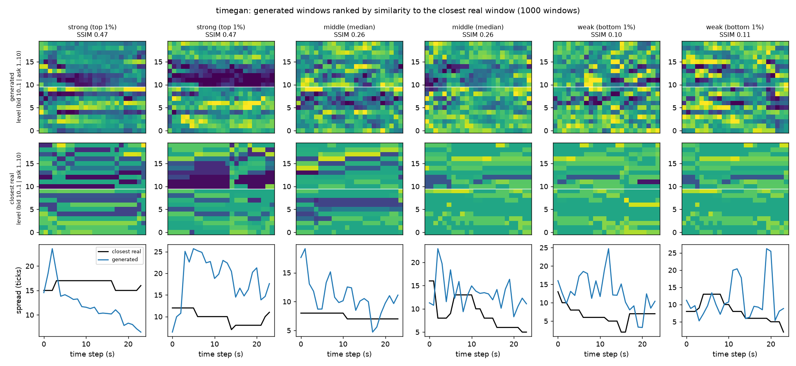

# TimeGAN Market Data Generation

TimeGAN for limit order book simulation (LOBSTER AMZN, Level 10).

Project 2.7 (Time-Series Generation: Limit Order Book and Market Simulation), Hard difficulty.

Author: Jamie Landolt (s4883946)

## Overview

**Problem.** Real order book data is expensive and its use is restricted, yet trading programs and risk tools need it for testing. We can make fake (synthetic) data instead, but that is hard to do well. An order book is the list of waiting buy and sell orders. It follows strict rules. The best bid (highest buy price) must be below the best ask (lowest sell price), written $P_{bid,1} < P_{ask,1}$; if not, the book is *crossed*, which would be a free-money trick that cannot happen. Prices must step away from the middle in order across the 10 levels. No level can have negative volume. Big price moves should come in bursts (*volatility clustering*), and returns should have fat tails. This project trains a **TimeGAN** on one day of Amazon (AMZN) order book data from LOBSTER. It checks whether the fake 24-second sequences follow these rules and look like the real ones, and it compares the result with a simpler GAN.

**How it works.** A GAN has two networks that compete: a *generator* makes fake data from random noise and a *discriminator* tries to tell fake from real. TimeGAN (Yoon, Jarrett and van der Schaar, NeurIPS 2019) adds three things for data that changes over time. An *embedder* and a *recovery* network (together an autoencoder) squeeze each sequence into a short summary (the *latent space*) and back. A *supervisor* learns what usually comes next in the summary. Training has three steps: the autoencoder first, then the supervisor, then everything together. To make data, random noise goes into the generator, the supervisor tidies the result, and the recovery network turns it back into prices and volumes. Each sequence is 24 seconds long, one step per second, with 41 numbers per step: the price change, the distance of each of 10 ask and 10 bid levels from the middle price, and the volume at each of those 20 levels. The fake sequences are checked for crossed books, bad price ladders and negative volume, and compared with real held-out data using KL divergence, SSIM and volatility clustering (see the word list below). The baseline is a plain GAN with no autoencoder or supervisor.

```
real window x --Embedder--> h --Recovery--> x~          (reconstruction loss)
                            |
                            +--Supervisor--> next-step prediction of h  (supervised loss)

noise z --Generator--> e^ --Supervisor--> h^ --Recovery--> x^   (synthetic window)

Discriminator: real latents h   vs   generated latents h^, e^    (adversarial loss)
```

## Example output

**Ten minutes, real against fake.** The left side is ten minutes of the real afternoon order book. The right side is the same length made by the final TimeGAN. From top to bottom: the middle price with the best bid and ask, the spread in ticks, the depth picture (bid levels 10 to 1, then ask levels 1 to 10) and the size of each one-second price move. The fake side is 25 separate 24-second windows joined end to end (dashed lines show the joins), so it has no memory from one window to the next. The model gets the size and rhythm of the price moves and the range of the spread about right. It does not copy how the real book holds its values: the fake spread changes every second, the fake depth is fine-grained and not blocky, and the fake prices fall between tick marks (see the failure case autopsy). Made with `plot_comparison.py`.


**Strong, middle and weak windows.** To avoid showing only good cases, every fake window is scored by how close its depth picture is to its closest real picture (SSIM). The figure shows two windows at the 99th percentile (strong), two at the median (middle) and two at the 1st percentile (weak). Each has its closest real window underneath and the spread below that. Even the strong windows are fuzzier than the real ones: real depth is in flat blocks and fake depth is speckled. Over 1,000 windows the scores run from 0.09 to 0.57, with a median of 0.26. Made with `plot_examples.py`.



## Results at a glance

**Short version.** The model never made a crossed book, matches the real return distribution well, and keeps price bursts at about the right level. It is weaker on the spread (the gap between best bid and best ask) and on the depth picture.

**The assignment targets are too hard for any model on this data.** The assignment asks for KL ≤ 0.1 and SSIM > 0.6. We only have one trading day, so the day is cut by time: the morning trains the model and the afternoon tests it. The afternoon is different from the morning (for example, the average spread is $0.14 in the morning and $0.11 in the afternoon). So we asked a fair question: how well does **real morning data** score against the real afternoon? That is about the best any perfect fake data could do. Real data scores KL of about 0.2 and SSIM of about 0.3, so it misses both targets too. Our results should be read against the third column below, and not only against the targets.

| Measure | Assignment target | Real morning vs real afternoon (best we can expect) | Final TimeGAN (1 s step) |
|---|---|---|---|
| Crossed books (lower is better) | none | 0 | 0 in every run |
| KL of returns (lower is better) | ≤ 0.1 | 0.19 | 0.167 (0.128 with fewer options); 0.069 at a 5 s step |
| KL of spread (lower is better) | ≤ 0.1 | 0.22 | 1.31 raw; 0.31 after rounding to whole ticks |
| SSIM of depth pictures (higher is better) | > 0.6 | 0.30 | 0.27 (0.378 at a 0.5 s step, where real is 0.381) |
| Bad price ladders (lower is better) | none | 0 | 7.5% of snapshots |

More detail is in Evaluation and Experiments below.

## Words used in this report

| Word | Meaning |
|---|---|
| Order book | The list of waiting buy (bid) and sell (ask) orders, with 10 price levels on each side |
| Mid-price | The price halfway between the best bid and the best ask |
| Spread | The gap between the best ask and the best bid |
| Tick | The smallest price step, $0.01 |
| Depth | How many shares are waiting at each price level |
| Window | A 24-second slice of order book data |
| Crossed book | Best bid at or above best ask, which cannot happen in a real market |
| Ladder | Prices must move further from the middle as the level number goes up; a *bad ladder* breaks this |
| KL divergence | A score of how different two sets of numbers are; 0 means the same, lower is better |
| SSIM | A score of how similar two pictures are; 1 means identical, higher is better. Here the pictures are depth heatmaps |
| Volatility clustering | Big price moves come in bursts. Measured by ACF (autocorrelation) of absolute returns: above 0 means bursts, about 0 means no pattern |
| Baseline | A plain GAN with no autoencoder or supervisor, used for comparison |
| Seed | The random starting point of a run; each setting is repeated with 3 seeds |

## Files

| File | Purpose |
|---|---|
| `modules.py` | TimeGAN networks and the recurrent-GAN baseline (PyTorch only) |
| `dataset.py` | Loading, 1-second resampling, features, return transforms, chronological split, windows, data loaders |
| `train.py` | Training, validation, test and checkpointing for both models; loss curves |
| `predict.py` | Loads trained weights, samples windows, compares with real data, saves figures |
| `metrics.py` | Microstructure audit, KL divergence, volatility clustering, depth-heatmap SSIM |
| `test_pipeline.py` | Unit and end-to-end tests (use a small fake order book, no real data needed) |
| `audit_data.py`, `plot_returns.py` | Real-data audit and return-distribution figure |
| `analyse_failures.py` | Failure analysis: tick grid, ladder violation size, negative depth |
| `plot_comparison.py`, `plot_examples.py` | Real-against-fake figures: ten minutes side by side, and strong, middle and weak windows |
| `slurm_train.sh`, `slurm_pack.sh`, `run_experiments.sh`, `summarise_runs.py` | Running and summarising experiments on the Rangpur cluster |

## Dependencies and reproducibility

Results were produced on the Rangpur cluster (NVIDIA A100 GPUs) with these exact versions:

| Package | Version |
|---|---|
| Python | 3.11.15 |
| PyTorch | 2.13.0+cu130 |
| NumPy | 2.4.6 |
| SciPy | 1.17.1 |
| Matplotlib | 3.11.1 |
| scikit-image | 0.26.0 |

`modules.py` uses only PyTorch. The LOBSTER data files are **not** in the repository (course rule). Put the two CSV files in one folder and pass it with `--data-dir`. Every run takes `--seed`. Numbers in the tables are the average and spread (± standard deviation) over seeds 0, 1 and 2. GPU training is not exactly repeatable, so single runs can differ a little.

## Usage

The code is on the `topic-recognition` branch, so after cloning the repository switch to it and move into the project folder:

```bash
git checkout topic-recognition
cd recognition/TimeGAN_s4883946
pip install torch numpy scipy matplotlib scikit-image   # versions in the table above
```

`<data_dir>` below is the folder holding the LOBSTER files `AMZN_2012-06-21_34200000_57600000_orderbook_10.csv` and `AMZN_2012-06-21_34200000_57600000_message_10.csv` (the data is not committed, so supply your own copy). Training, `predict.py` and `plot_comparison.py` also need trained model files, which are not committed either, so train first with the commands below.

```bash
# unit and end-to-end tests (no real data needed)
python -m unittest test_pipeline -v

# audit of the real data, and the return-distribution figure
python audit_data.py <data_dir>
python plot_returns.py <data_dir> figures/return_distribution.png

# train (outputs/<model>.pt, <model>_summary.json, <model>_training.png)
python train.py --model timegan  --data-dir <data_dir> --out-dir outputs
python train.py --model baseline --data-dir <data_dir> --out-dir outputs
# optional TimeGAN changes studied below:
#   --return-transform quantile --ladder increments --feature-adv --w-diff 10 --step 1

# sample from the trained models, print the comparison table and save figures
python predict.py --data-dir <data_dir> --model-dir outputs

# ten minutes of real test data next to generated data (the example-output figure)
python plot_comparison.py --data-dir <data_dir> --model-dir outputs --model timegan \
    --minutes 10 --out figures/real_vs_timegan_window.png

# strong, middle and weak generated windows next to their closest real windows
python plot_examples.py --data-dir <data_dir> --model-dir outputs --model timegan \
    --out figures/examples_strong_middle_weak.png

# on Rangpur (Slurm): one run, or a whole experiment group
sbatch --job-name=lob_timegan slurm_train.sh timegan
./run_experiments.sh transform        # also: step, loss, depth, ladder, combined
python summarise_runs.py outputs/transform
```

## Feasibility Review

**Audience:** project manager (tutor). **Question under review:** can a TimeGAN make fake order books that are safe to use for testing trading programs? That means they must follow the market rules, and not only look believable.

### 1. User need, scope and acceptance criteria

The intended user is a developer who wants realistic order books to test trading programs without paying for tick data. The prototype makes windows of 10-level order book snapshots and checks them against the market rules. All criteria are measured on a held-out, later part of the day, and compared with the baseline on the same split:

1. **Valid books:** crossed or locked books (best bid at or above best ask, $P_{bid,1} \geq P_{ask,1}$) are counted per 1,000 snapshots. The real data has none (see below). Target: 0 for the final model. The baseline's count is reported for comparison.
2. **Right distributions:** KL divergence between real and fake spread, and between real and fake mid-price returns, of at most 0.1 (assignment target). Real morning data already scores about 0.2 against the afternoon (section 3), so the best score we can expect is shown next to every result.
3. **Right depth pictures:** SSIM above 0.6 between real and fake depth pictures (price level by time step) (assignment target). Real windows only reach about 0.28 against their closest real window, so results are shown against that limit too.
4. **Bursty price moves:** the autocorrelation of absolute returns inside 24-step windows at lags 1, 5 and 10 is above 0 and falls away as in the real test data (0.14 / 0.08 / 0.005). It should not drop to about 0 (pure noise) or stay far too high.
5. **Cost:** at most 2 GB of GPU memory and 30 minutes of training per model on one GPU (the first full runs used 0.57 GB and 9 minutes for TimeGAN).

### 2. Model choice and course concepts

- **Dataset:** LOBSTER sample, AMZN, 2012-06-21, 09:30 to 16:00, 10 levels, 269,748 events. Prices are in units of 1/10,000 dollar.
- **Model:** TimeGAN (Yoon, Jarrett and van der Schaar, NeurIPS 2019). It is a GAN plus an autoencoder and a next-step loss in the latent space. These extra parts are meant to help it learn how data changes over time better than a plain GAN. **Difficulty band:** Hard.
- **Baseline:** a plain recurrent GAN (GRU generator and discriminator) with only the adversarial loss. Comparing the two shows what TimeGAN's extra parts add.
- **Preprocessing:** log-returns for prices, log scaling for volumes, resampling onto a fixed 1-second grid, and a split by time (no shuffling across time, so the model never learns from the future).
- **Course concepts:** GAN training and its problems (mode collapse, balancing the two networks), recurrent networks and autoencoders. Sources: the TimeGAN paper above and the LOBSTER data description (Huang and Polak, 2011).

### 3. Preliminary feasibility evidence (data audit)

`audit_data.py` was run on the real sample on Rangpur. Findings:

| Check | Result |
|---|---|
| Crossed or locked books | 0 of 269,748 |
| Non-monotonic bid or ask ladders | 0 |
| Negative or zero depth | 0 |
| Spread | $0.01 to $0.77 (median $0.13) |
| Zero mid-price change per event / per 1 s grid step | 89.8% / 70.1% |
| Return kurtosis per event / per 1 s grid step | about 203 / 38.5 (Gaussian = 3) |
| Autocorrelation of absolute returns, per event (lags 1 / 5 / 20) | 0.25 / 0.15 / 0.10 |


What this means: (a) the real data is clean, so any broken rule in fake data comes from the model; (b) volatility clustering is present, so we can test for it; (c) returns have a big spike at zero and very fat tails (figure), so I use a 1-second grid and not raw events; (d) volumes are very uneven (median 100, max 5,700 shares), so I use log scaling.

**Early results (first full runs, one seed, on Rangpur):** TimeGAN has 480k parameters, trained in about 9 minutes and used 0.57 GB of GPU memory; the baseline took about 2 minutes. Neither made a crossed book. The baseline broke the price ordering in 98.6% of snapshots and TimeGAN in 14.6%, so the main question can be measured. Neither is near the distribution targets (KL about 1.3 for spread and returns, against about 0.2 for real morning against afternoon). Real windows only reach about 0.28 SSIM against their closest real window, so a perfect generator would not reach 0.6 with this definition.

### 4. Risks, budget and fallback

| Risk | Mitigation |
|---|---|
| The sample is a single trading day, so the "later hours" test set is small and the result may not carry over to other days | Say so openly; split by time and report the spread between runs instead of claiming the result holds for all markets |
| Return KL ≤ 0.1 may be very hard: real returns have a sharp spike at zero (70% zeros) and fat tails (kurtosis 38.5), but a generator fed Gaussian noise and trained with MSE and moment-matching losses tends to give a smooth bell shape, which the first run is consistent with (a guess, not yet tested). A few extreme values may also dominate z-scoring. KL is also noisy in rare tails and depends on the bin choice | Fix the binning rule up front and report it; compare plain z-score, clipped and quantile transforms, and compare each against the real train-vs-test KL of about 0.2 |
| The spec's KL ≤ 0.1 and SSIM > 0.6 targets may be impossible on a single day of data (real train-vs-test KL about 0.2; real-vs-closest-real SSIM about 0.28) | Report every result next to these real-data numbers, so we can tell how much of any gap comes from the single day and how much from the model |
| TimeGAN training instability or mode collapse | Train the baseline first, monitor losses and sample diversity, tune the learning rate and the balance of the three losses |
| Raw TimeGAN outputs are not forced to follow the rules and may cross the book | Report violation rates on the raw outputs as the main result. Any fix applied while decoding (for example forcing a positive spread) is reported separately, because it would not show the model learning the rule |
| Rangpur GPU queue time | Short smoke-test jobs first, then one longer batch job |

**Budget:** one GPU on the `comp3710` partition via Slurm. A full TimeGAN run takes about 9 minutes, so there is room for repeated runs and several seeds.
**Next experiment:** the normalisation test above, measured on the same time-ordered validation and test splits, plus repeat runs with different seeds so differences between models are not single-run noise.
**Fallback:** if TimeGAN will not train steadily, report the baseline plus a simpler TimeGAN with shorter windows, and describe the failures honestly. The project question is whether the model follows the rules, not only whether it works.

## Data and preprocessing

**Data.** LOBSTER sample file for AMZN on 2012-06-21, 09:30 to 16:00, 10 price levels: 269,748 order book events (Huang and Polak, 2011). Prices are stored in units of 1/10,000 dollar, and the smallest price step (tick) is $0.01.

**Preprocessing** (all in `dataset.py`):

1. **Resample onto a 1-second grid.** Events arrive at uneven times and about 90% of them leave the mid-price unchanged. For each second, the book is its state after the last event at or before that time. This gives 23,400 evenly spaced snapshots. 70% of 1-second mid-returns are still exactly zero (90% per event), and the kurtosis (how fat the tails are) falls from about 203 to 38.5.
2. **41 features per step.** The mid-price log-return `ln(P_t / P_{t-1})`; the distance of each of the 10 ask and 10 bid levels from the mid-price in ticks, as `log1p(distance)`; and `log1p(volume)` for each of the 20 levels (volumes are very uneven: median 100, maximum 5,700 shares). Using distances from the mid-price turns the market rules into simple sign and order checks. This lets us test whether the model learned the rules, instead of building them in.
3. **Optional return transform** (`--return-transform`): plain z-scoring, clipping extreme values at the 0.5th and 99.5th percentiles (`clip`), or a quantile transform (`quantile`) that maps returns to normal scores using the training data's empirical CDF. In the quantile transform all exact zeros map to one value, and decoding sends a whole band of scores back to exactly 0, so the generator does not need to output exact zeros.
4. **Optional ladder form** (`--ladder`): either the distance of every level from the mid-price (`levels`), or the distance of level 1 followed by the gap between neighbouring levels (`increments`). Real gaps are always at least one tick, so with `increments` the model only needs positive gaps to keep the ladder in order. Nothing is forced: a negative decoded gap still counts as a violation.
5. **Split by time, then normalise.** Each feature is z-scored using the mean and standard deviation of the **training part only**.
6. **Windows.** Overlapping 24-step windows (moving one step at a time), made inside each part.

**Splits and why.** The day is split in time order with no shuffling: the first 60% for training (09:30 to 13:24), the next 20% for validation (13:24 to 14:42) and the last 20% for testing (14:42 to 16:00). The model only sees earlier data than it is checked on, so it cannot peek at the future. Windows never cross a split boundary, and the normalisation numbers and the quantile transform are fitted on training data only, so nothing leaks. This gives 14,017 training, 4,657 validation and 4,657 test windows. Validation picks the best checkpoint during training; the test part is used only for the final numbers. Because the data is a single day, the test part is a later time of the same day and not a different day, so results say little about other days.


*Real 1-second mid-returns have a sharp spike at zero (70% exact zeros) and far heavier tails than a Gaussian of the same standard deviation (kurtosis 38.5 against 3).*

## Evaluation

All metrics compare generated windows with **real test windows** (`metrics.py`).

- **Rule checks** (per snapshot): *crossed* (best ask not above best bid), *ladder* (ask prices not rising, or bid prices not falling, as the level number goes up) and *negative depth*.
- **KL divergence** between real and fake spread, and between real and fake 1-step mid-returns. It scores how different two sets of numbers are (0 means the same). The bins are fixed so results can be compared: 50 equal bins between the 0.5th and 99.5th percentile of the real data plus two open end bins, with a tiny number added to each bin so empty bins do not break the maths.
- **Volatility clustering:** autocorrelation of absolute returns inside windows at lags 1 and 5 (do big moves follow big moves?).
- **SSIM of depth pictures.** Each window's depth is a 20 x 24 picture: rows are the bid levels 10 to 1 then the ask levels 1 to 10, columns are the 24 seconds, and colour is `log(1 + volume)`. Each fake picture is compared with its closest real picture (smallest L2 distance) and the SSIM is averaged over 300 fake windows. This is a strict test, so every table also shows the **real-data reference**: the same score for real training windows against real test windows, which is about the best a perfect generator could hope for.

**Real-data reference.** The test period differs from the training period (the average spread is $0.14 in training and $0.11 in test), so even real training data does not match the test period perfectly. At the 1-second step it scores KL about 0.22 for spread and 0.19 for returns, and SSIM 0.30. The assignment targets (KL ≤ 0.1, SSIM > 0.6) should be read with these numbers in mind.

## Experiments and results

**Protocol.** Every setting was trained with three seeds (0, 1, 2) for the models it applies to, for the same number of epochs as the control (TimeGAN: 30 autoencoder, 30 supervised and 100 joint epochs; baseline: 100 epochs). The checkpoint with the best *validation* KL (spread plus return) was scored once on the *test* split. Tables show the average ± standard deviation over the three seeds. Only one thing is changed at a time against the control (z-score returns, `levels` ladder, 1-second step, default loss weights). Crossed books were 0 in every run, so that column is left out. The *real (train vs test)* row is the reference from the Evaluation section. Its ACF values are for real training windows; the test period itself has 0.14 (lag 1) and 0.08 (lag 5). Differences below are bigger than the seed-to-seed spread unless said otherwise. With only three seeds, small gaps may be noise.

### 1. Return transform

| Setting | Model | Ladder violations | KL spread | KL return | SSIM | ACF lag 1 | ACF lag 5 |
|---|---|---|---|---|---|---|---|
| z-score (control) | TimeGAN | 0.214 ± 0.052 | 1.493 ± 0.076 | 1.279 ± 0.065 | 0.238 ± 0.014 | 0.382 ± 0.096 | 0.277 ± 0.036 |
| z-score (control) | Baseline GAN | 0.990 ± 0.003 | 1.237 ± 0.085 | 1.272 ± 0.045 | 0.382 ± 0.016 | 0.345 ± 0.090 | 0.152 ± 0.067 |
| z-score (control) | *real (train vs test)* | 0.000 | 0.220 | 0.190 | 0.298 | 0.155 | 0.044 |
| clip | TimeGAN | 0.280 ± 0.054 | 1.570 ± 0.111 | 1.463 ± 0.115 | 0.223 ± 0.020 | 0.283 ± 0.134 | 0.170 ± 0.096 |
| clip | Baseline GAN | 0.995 ± 0.006 | 1.607 ± 0.222 | 1.459 ± 0.818 | 0.336 ± 0.043 | 0.324 ± 0.065 | 0.158 ± 0.158 |
| quantile | TimeGAN | 0.303 ± 0.070 | 1.474 ± 0.034 | 0.117 ± 0.009 | 0.208 ± 0.036 | 0.097 ± 0.017 | 0.078 ± 0.012 |
| quantile | Baseline GAN | 0.985 ± 0.015 | 1.402 ± 0.262 | 0.216 ± 0.053 | 0.350 ± 0.054 | 0.020 ± 0.030 | 0.002 ± 0.038 |

The quantile transform is the biggest single improvement to the return distribution: TimeGAN's return KL falls from 1.279 to **0.117 ± 0.009** (target ≤ 0.1) and the baseline's from 1.272 to 0.216. It also brings volatility clustering close to the real test period for TimeGAN (0.097 and 0.078 at lags 1 and 5, against 0.14 and 0.08 real; the control gave 0.38 and 0.28), while the baseline loses clustering almost completely (0.020 and 0.002). Clipping did not help (KL 1.463). The quantile transform does not change the spread KL (about 1.4 to 1.5) or the ladder violations. One caution: decoding sends a band of scores to exactly zero, so the model does not have to learn exact zeros itself. Part of the gain comes from the data form and not only from learning. The 0.117 is below the real-data reference (0.19), so that reference is not a hard limit.

### 2. Price ladder representation

| Setting | Model | Ladder violations | KL spread | KL return | SSIM | ACF lag 1 | ACF lag 5 |
|---|---|---|---|---|---|---|---|
| levels (control) | TimeGAN | 0.214 ± 0.052 | 1.493 ± 0.076 | 1.279 ± 0.065 | 0.238 ± 0.014 | 0.382 ± 0.096 | 0.277 ± 0.036 |
| levels (control) | Baseline GAN | 0.990 ± 0.003 | 1.237 ± 0.085 | 1.272 ± 0.045 | 0.382 ± 0.016 | 0.345 ± 0.090 | 0.152 ± 0.067 |
| levels (control) | *real (train vs test)* | 0.000 | 0.220 | 0.190 | 0.298 | 0.155 | 0.044 |
| increments | TimeGAN | 0.039 ± 0.006 | 1.468 ± 0.113 | 1.183 ± 0.050 | 0.215 ± 0.048 | 0.047 ± 0.028 | 0.029 ± 0.018 |
| increments | Baseline GAN | 0.091 ± 0.030 | 1.388 ± 0.138 | 1.534 ± 0.058 | 0.350 ± 0.025 | 0.337 ± 0.141 | 0.116 ± 0.087 |

Predicting the gaps between levels instead of each level's distance cuts bad ladders from 21.4% to **3.9%** for TimeGAN and from 99.0% to **9.1%** for the baseline, with no cost to the other metrics for TimeGAN. The cost is weaker volatility clustering (0.047 and 0.029 for TimeGAN, against 0.14 and 0.08 real). Neither model is forced to be valid: a negative decoded gap still counts as a violation. So this shows the models learn the ordering more easily, not that a rule is enforced.

### 3. TimeGAN loss and model changes

| Setting | Model | Ladder violations | KL spread | KL return | SSIM | ACF lag 1 | ACF lag 5 |
|---|---|---|---|---|---|---|---|
| default (control) | TimeGAN | 0.214 ± 0.052 | 1.493 ± 0.076 | 1.279 ± 0.065 | 0.238 ± 0.014 | 0.382 ± 0.096 | 0.277 ± 0.036 |
| default (control) | *real (train vs test)* | 0.000 | 0.220 | 0.190 | 0.298 | 0.155 | 0.044 |
| mean/std loss weight 0 | TimeGAN | 0.791 ± 0.077 | 1.231 ± 0.043 | 1.504 ± 0.070 | 0.328 ± 0.122 | 0.309 ± 0.029 | 0.041 ± 0.223 |
| mean/std loss weight 10 | TimeGAN | 0.200 ± 0.066 | 1.538 ± 0.142 | 1.387 ± 0.190 | 0.259 ± 0.036 | 0.214 ± 0.108 | 0.158 ± 0.124 |
| supervised weight 10 | TimeGAN | 0.400 ± 0.170 | 1.463 ± 0.095 | 1.514 ± 0.047 | 0.217 ± 0.037 | 0.271 ± 0.160 | 0.139 ± 0.075 |
| + feature discriminator | TimeGAN | 0.248 ± 0.040 | 1.498 ± 0.042 | 0.736 ± 0.076 | 0.277 ± 0.013 | 0.276 ± 0.058 | 0.156 ± 0.165 |
| cosine LR, 150 epochs | TimeGAN | 0.159 ± 0.090 | 1.548 ± 0.007 | 1.364 ± 0.155 | 0.258 ± 0.049 | 0.259 ± 0.112 | 0.138 ± 0.066 |

- The **mean/std matching loss is what keeps the ladder in order**: switching it off lets bad ladders rise to 79%, even though it gives the lowest spread KL (1.231).
- A **second discriminator on the decoded features** (`--feature-adv`) lowers the return KL from 1.279 to 0.736 and raises SSIM slightly (0.238 to 0.277). It costs 190k extra parameters (479,914 to 670,123) and about 50 MB more GPU memory.
- A lower supervised weight (10), a lower mean/std weight (10) and a cosine learning-rate schedule with 150 epochs gave no clear gain beyond seed noise.

### 4. Depth structure: difference loss

| Setting | Model | Ladder violations | KL spread | KL return | SSIM | ACF lag 1 | ACF lag 5 |
|---|---|---|---|---|---|---|---|
| difference loss weight 10 | TimeGAN | 0.258 ± 0.075 | 1.551 ± 0.164 | 1.417 ± 0.046 | 0.287 ± 0.058 | 0.344 ± 0.110 | 0.165 ± 0.018 |
| difference loss weight 10 | *real (train vs test)* | 0.000 | 0.220 | 0.190 | 0.298 | 0.155 | 0.044 |
| difference loss weight 100 | TimeGAN | 0.157 ± 0.060 | 1.584 ± 0.191 | 1.489 ± 0.059 | 0.275 ± 0.032 | 0.091 ± 0.107 | 0.052 ± 0.044 |

Real depth holds its volumes and then jumps. Adding moment matching on first differences over time raises SSIM from 0.238 to 0.287 ± 0.058 (real reference 0.298), but the gain is only about one standard deviation, so it hints at an improvement and does not prove one. With the larger weight (100) volatility clustering falls close to real (0.091 and 0.052), while the return KL stays high on z-scored returns.

### 5. Grid step size

| Setting | Model | Ladder violations | KL spread | KL return | SSIM | ACF lag 1 | ACF lag 5 |
|---|---|---|---|---|---|---|---|
| 0.5 s | TimeGAN | 0.264 ± 0.018 | 1.582 ± 0.188 | 1.601 ± 0.036 | 0.375 ± 0.007 | 0.395 ± 0.033 | 0.292 ± 0.013 |
| 0.5 s | Baseline GAN | 0.973 ± 0.020 | 1.490 ± 0.305 | 1.335 ± 0.304 | 0.424 ± 0.055 | 0.395 ± 0.218 | 0.146 ± 0.161 |
| 0.5 s | *real (train vs test)* | 0.000 | 0.221 | 0.013 | 0.381 | 0.106 | 0.035 |
| 1 s (control) | TimeGAN | 0.214 ± 0.052 | 1.493 ± 0.076 | 1.279 ± 0.065 | 0.238 ± 0.014 | 0.382 ± 0.096 | 0.277 ± 0.036 |
| 1 s (control) | Baseline GAN | 0.990 ± 0.003 | 1.237 ± 0.085 | 1.272 ± 0.045 | 0.382 ± 0.016 | 0.345 ± 0.090 | 0.152 ± 0.067 |
| 1 s (control) | *real (train vs test)* | 0.000 | 0.220 | 0.190 | 0.298 | 0.155 | 0.044 |
| 5 s | TimeGAN | 0.093 ± 0.013 | 1.474 ± 0.061 | 0.409 ± 0.137 | 0.232 ± 0.061 | 0.435 ± 0.161 | 0.149 ± 0.055 |
| 5 s | Baseline GAN | 0.992 ± 0.011 | 4.658 ± 2.858 | 3.462 ± 1.169 | 0.165 ± 0.084 | 0.499 ± 0.446 | 0.412 ± 0.441 |
| 5 s | *real (train vs test)* | 0.000 | 0.225 | 0.057 | 0.205 | 0.140 | 0.050 |
| 10 s | TimeGAN | 0.077 ± 0.017 | 1.593 ± 0.041 | 0.355 ± 0.184 | 0.174 ± 0.021 | 0.368 ± 0.200 | 0.163 ± 0.112 |
| 10 s | Baseline GAN | 0.970 ± 0.016 | 6.882 ± 3.067 | 2.985 ± 1.274 | 0.128 ± 0.027 | 0.685 ± 0.052 | -0.300 ± 0.256 |
| 10 s | *real (train vs test)* | 0.000 | 0.222 | 0.131 | 0.180 | 0.157 | 0.107 |

Larger steps help TimeGAN: the return KL falls from 1.279 (1 s) to 0.409 (5 s) and 0.355 (10 s), and bad ladders from 21.4% to 9.3% and 7.7%. The baseline GAN breaks down at coarse steps (spread KL 4.66 and 6.88, return KL 3.46 and 2.99), so TimeGAN is more robust there. At the finest step (0.5 s) TimeGAN's SSIM (0.375) is almost at the real ceiling (0.381), because depth changes more smoothly over a shorter time. Each step size has its own real reference, because a window covers a different span of time (24 steps is 12 seconds, 24 seconds, 2 minutes or 4 minutes), so KL and SSIM cannot be compared directly across steps. Coarser steps also leave far fewer training windows (about 2,800 at 5 s and 1,400 at 10 s), which may explain the baseline's instability.

### What did not move: the spread

Across every setting the spread KL stays between 1.2 and 1.6, against a real-data reference of 0.22. The lowest values (1.231 with no mean/std loss, and 1.237 for the baseline) come from models whose ladders are mostly invalid. The spread is the sum of the best ask distance and the best bid distance, which are made separately, so their small errors add up. Modelling the spread directly is an untested idea for future work.

### 6. Combined configuration

The changes that helped were combined: the quantile return transform and the ladder-increments form for **both** models, and, for TimeGAN only, the feature discriminator and the difference loss (weight 10), at three step sizes. TimeGAN's extra options have no match in the baseline, so once they are added the comparison is not like for like. The `quantile + ladder increments, 1 s` rows are the fair comparison.

| Setting | Model | Ladder violations | KL spread | KL return | SSIM | ACF lag 1 | ACF lag 5 |
|---|---|---|---|---|---|---|---|
| quantile + ladder increments, 1 s | TimeGAN | 0.079 ± 0.019 | 1.342 ± 0.062 | 0.128 ± 0.010 | 0.135 ± 0.005 | 0.079 ± 0.049 | 0.012 ± 0.017 |
| quantile + ladder increments, 1 s | Baseline GAN | 0.089 ± 0.004 | 1.325 ± 0.171 | 0.142 ± 0.037 | 0.239 ± 0.041 | -0.018 ± 0.093 | 0.059 ± 0.044 |
| quantile + ladder increments, 1 s | *real (train vs test)* | 0.000 | 0.220 | 0.190 | 0.298 | 0.155 | 0.044 |
| + feature discriminator + difference loss, 1 s | TimeGAN | 0.075 ± 0.028 | 1.306 ± 0.079 | 0.167 ± 0.035 | 0.265 ± 0.019 | 0.115 ± 0.017 | 0.026 ± 0.012 |
| + feature discriminator + difference loss, 1 s | *real (train vs test)* | 0.000 | 0.220 | 0.190 | 0.298 | 0.155 | 0.044 |
| same, 0.5 s step | TimeGAN | 0.116 ± 0.013 | 1.498 ± 0.180 | 0.084 ± 0.016 | 0.378 ± 0.018 | 0.090 ± 0.022 | 0.029 ± 0.019 |
| same, 0.5 s step | *real (train vs test)* | 0.000 | 0.221 | 0.013 | 0.381 | 0.106 | 0.035 |
| same, 5 s step | TimeGAN | 0.038 ± 0.006 | 1.354 ± 0.059 | 0.069 ± 0.006 | 0.166 ± 0.019 | 0.053 ± 0.071 | 0.059 ± 0.015 |
| same, 5 s step | *real (train vs test)* | 0.000 | 0.225 | 0.057 | 0.205 | 0.140 | 0.050 |

- **Fair comparison (quantile + ladder increments, 1 s).** The baseline almost catches TimeGAN: return KL 0.142 ± 0.037 against 0.128 ± 0.010, and bad ladders 8.9% against 7.9%. These two data changes explain most of the gain over the controls, and TimeGAN's own losses add little on these measures.
- **TimeGAN with all options at 1 s.** Bad ladders 7.5%, return KL 0.167 ± 0.035 (worse than without the extra options, 0.128), SSIM 0.265 (better than 0.135 without them), and volatility clustering at lag 1 close to the real test period (0.115 against 0.139) but too weak at lag 5 (0.026 against 0.080).
- **Step size.** With everything combined, the return KL is **0.084 ± 0.016 at 0.5 s** and **0.069 ± 0.006 at 5 s**, both under the 0.1 target; the 5 s value is close to its real reference (0.057). At 5 s bad ladders fall to 3.8%. At 0.5 s SSIM reaches 0.378, almost the real ceiling (0.381).
- **Spread KL** is still 1.3 to 1.5 in every combined setting. The next section shows that most of it comes from prices sitting between ticks.
- **Targets (assignment values).** Return KL ≤ 0.1: met at 0.5 s and 5 s, not at 1 s. Spread KL ≤ 0.1: not met (about 0.3 after rounding to whole ticks; real reference 0.22). SSIM > 0.6: not met; the best is 0.378, and real windows reach at most 0.381 at that step.

## Resource profile

| Model and setting | Parameters | Training time | Peak GPU memory | Sampling 1,000 windows |
|---|---|---|---|---|
| TimeGAN, control (one run alone on an A100) | 479,914 | 549 s | 573 MB | 2 ms |
| Baseline GAN, control (one run alone) | 263,338 | 125 s | 535 MB | 1 ms |
| TimeGAN, all options, 1 s (8 runs sharing one GPU) | 670,123 | 806 s | 623 MB | 2 ms |
| TimeGAN, all options, 0.5 s (shared) | 670,123 | 1,463 s | 646 MB | 2 ms |
| TimeGAN, all options, 5 s (shared) | 670,123 | 209 s | 646 MB | 2 ms |
| Baseline GAN, quantile + increments, 1 s (shared) | 263,338 | 206 s | 535 MB | 1 ms |

Peak memory is the largest PyTorch memory use on one NVIDIA A100. Times marked *shared* come from runs packed eight to one GPU, so they are longer than a run alone (the control TimeGAN took 549 s alone, and between 589 s and 1,140 s when 6 to 8 runs shared a GPU). Every model fits in under 1 GB, so the limit set in the feasibility review (2 GB, 30 minutes per model) is met. Compared with the baseline, TimeGAN with all options needs about 4 times the training time and 2.5 times the parameters; TimeGAN with only the quantile and ladder changes needs about 3 times the training time and 1.8 times the parameters.

Training curves for the final TimeGAN and its matched baseline (seed 0):  

## Failure case autopsy

These five cases come from the final TimeGAN (quantile transform, ladder increments, feature discriminator, difference loss, 1 s step) and its matching baseline, using `predict.py` and `analyse_failures.py`. Figures are from seed 0; percentages given as averages are over seeds 0, 1 and 2.

**Case 1: fake spreads fall between price ticks.** Real prices sit on a $0.01 grid, so real spreads are whole ticks. About 80% of fake spreads are more than 0.1 tick off the grid, for both models (figure below). Rounding the fake spreads to whole ticks lowers the spread KL from 1.26 to **0.31** for TimeGAN (seeds: 1.20, 1.39, 1.18 to 0.25, 0.45, 0.22) and from 1.32 to 0.33 for the baseline, against a real reference of 0.22. *Cause:* prices are made as continuous numbers and nothing pushes them onto whole ticks. Most of the stuck spread KL is this rule being broken, not a failure to learn the usual size of the spread. Rounding is a market rule applied while decoding, so it is reported separately and not used in the main tables.


**Case 2: bad ladders are small dips near the best price.** 7.6% of TimeGAN snapshots (seeds: 11.3%, 4.2%, 7.3%) and 8.8% of baseline snapshots have a ladder that is not strictly in order. In every run, 100% of these dip by at most one tick, and 25% to 45% (TimeGAN) involve levels 1 to 3. 95% of seed-0 TimeGAN snapshots have a gap between neighbouring levels below one tick (real data: 0%). *Cause:* the same between-ticks noise as Case 1. A real gap is at least one tick, so a fraction of a tick of noise can flip the order when a gap is exactly one tick. Crossed books never happened, because fake spreads are always several ticks wide (none below one tick). The worst snapshots are in the figure below.


**Case 3: depth lacks the real hold-then-jump behaviour.** In real depth pictures a volume stays at one level for several seconds and then jumps, which makes flat blocks. Fake pictures change almost every second, so they look like fine noise (figure below). The difference loss raised SSIM from 0.238 to 0.287 (real ceiling 0.298 at 1 s), but the picture is still noisy. *Cause:* volumes are made as separate continuous values at every step. SSIM is a weak detector of this: noisy fake pictures still score close to the real ceiling (0.265 against 0.298), so the pictures tell more than the score.


**Case 4: a few snapshots contain negative volumes.** 0.54% of TimeGAN snapshots (seeds: 1.03%, 0.16%, 0.43%) and 0.69% of baseline snapshots have at least one volume below zero (about 0.04% to 0.1% of all level volumes). *Cause:* the output layer is linear and has no limits, and volumes are decoded with `expm1`, so a log-volume below zero gives a negative share count. Clamping while decoding would remove it.

**Case 5: volatility clustering is easy to get wrong in both directions.** With plain z-scored returns TimeGAN's clustering is far too strong (autocorrelation of absolute returns 0.38 at lag 1 and 0.28 at lag 5, against 0.14 and 0.08 in the real test period). With the quantile transform it comes close at lag 1 (0.115) but is too weak at lag 5 (0.026), and the baseline loses it altogether (-0.018 at lag 1). *Cause:* the return transform changes how much of a window's variation is carried by a few extreme returns, and no loss targets how long volatility lasts. The volatility figure is below.


## Enforced-rules variant

The failure cases above are all broken rules that a simple decoder can repair. `snap_to_rules` in `metrics.py` moves each fake window onto the market rules: the spread becomes a whole number of ticks and at least one tick (best ask and bid are placed evenly around the mid-price, as in the real data), every gap between neighbouring price levels becomes a whole number of ticks and at least one, and volumes become whole numbers and at least 1. Returns are not changed, and real windows pass through unchanged (tested). `predict.py` reports this variant next to the raw output. It **forces** the rules and does not show that the model learned them, so it is kept apart from the main results. It uses the same checkpoints as the combined setting (quantile transform, ladder increments, 1 s step; TimeGAN with the feature discriminator and difference loss), average ± standard deviation over seeds 0 to 2:

| Output | Model | Ladder violations | Negative depth | KL spread | KL return | SSIM |
|---|---|---|---|---|---|---|
| Raw | TimeGAN | 0.076 ± 0.029 | 0.005 ± 0.004 | 1.258 ± 0.094 | 0.163 ± 0.043 | 0.267 ± 0.026 |
| Raw | Baseline GAN | 0.088 ± 0.005 | 0.007 ± 0.001 | 1.317 ± 0.166 | 0.136 ± 0.048 | 0.242 ± 0.038 |
| Rules enforced | TimeGAN | 0.000 | 0.000 | **0.308 ± 0.101** | 0.163 ± 0.043 | 0.267 ± 0.026 |
| Rules enforced | Baseline GAN | 0.000 | 0.000 | **0.330 ± 0.198** | 0.136 ± 0.048 | 0.241 ± 0.038 |
| *Real (train vs test)* | | 0.000 | 0.000 | 0.220 | 0.194 | 0.284 |

Forcing the rules removes every ladder and depth violation and cuts the spread KL by about four times, to within about 0.1 of the real reference (0.22), but it is still above the 0.1 target. The seed-to-seed spread is large (TimeGAN 0.25, 0.45, 0.22). Return KL, SSIM and volatility clustering do not change, because the decoder does not touch returns and only rounds volumes. So the remaining gaps (depth that holds, the shape of the spread) come from what the models learned. TimeGAN's return KL here (0.163) is the 1-second value; the two settings under 0.1 were at 0.5 s and 5 s.

## Recommendation to the project manager

**Not yet reliable for testing a trading strategy, but a promising start.**

- **What works.** No run ever made a crossed book, so the main arbitrage risk did not appear. With the quantile transform, return distributions match the real ones closely (return KL 0.069 at 5 s and 0.084 at 0.5 s, both under the 0.1 target), and volatility clustering is near real at short lags.
- **What blocks use.** Fake prices are not on the tick grid (80% of spreads), about 8% of snapshots have a bad ladder, 0.5% to 0.7% contain negative volumes, and depth does not hold its values the way real waiting orders do. This matters for strategy tests, because how fast an order is filled depends on how long waiting volume stays. Spread KL is about 1.3 raw and about 0.3 with the rules-forced decoder, against 0.22 for real data and a target of 0.1.
- **Is TimeGAN worth its cost?** On these measures, mostly not at the 1-second step. With the same data fixes, the plain recurrent GAN is close behind (return KL 0.142 against 0.128; bad ladders 8.9% against 7.9%), while TimeGAN needs about 3 times the training time (669 s against 206 s) and 1.8 times the parameters. TimeGAN's clearer advantage appeared at coarse steps in the step-size test, where the plain GAN broke down at 5 s and 10 s (return KL above 2.9) and TimeGAN did not. The plain GAN with the quantile and ladder changes was not run at those steps, so that comparison is not like for like.
- **Next steps, in order.** (1) Use the rules-forced decoder for any use now (it removes the violations and brings the spread KL to about 0.3), and at the same time make the model itself output on-grid prices and valid gaps, for example by predicting whole tick counts, since the decoder only repairs the output. (2) Model the spread directly and generate volume changes instead of volume levels, to fix the depth behaviour the decoder cannot. (3) Get more than one trading day so results can be tested across days. More ideas are in Further development below.

## Limitations

- **One trading day.** The test period is the last 78 minutes of the same day, so nothing here shows how the models behave on other days or in other markets.
- **The test split was used to compare settings.** Each run's best checkpoint was chosen on validation data, but the settings tested in the ablations (and the final combined setting) were chosen by looking at test results. The final numbers are therefore a little optimistic, and there is no untouched test set.
- **Three seeds.** Small differences between settings are inside the seed-to-seed spread and should not be over-read.
- **KL depends on the bins and is noisy in rare tails.** The bin rule is fixed and stated, but other rules would give other values. The real-data reference rows are the right scale for judging them.
- **SSIM** compares noisy pictures and reaches only about 0.3 even for real data under the closest-window method, so the 0.6 target cannot be reached with that method.
- **Quantile transform.** Part of its return-KL gain comes from how decoding sends a band of scores to exactly zero, and not only from what the model learned.

## Further development

Ideas, in the order I would try them:

1. **Connect the windows.** Each 24-second window is made on its own, so prices and depth do not carry over from one window to the next. New windows could start from where the last one ended, or the model could make longer sequences in one go.
2. **Output whole ticks.** Predict prices as a whole number of ticks, so spreads and ladders sit on the grid and no repair step is needed.
3. **Let depth hold its value.** Real depth stays the same for several seconds, then jumps. The model could decide each second whether to keep or change a value (a "hold gate"; an early version is in `modules.py` but is not part of the reported results), or predict changes in volume instead of volumes.
4. **Model the spread directly** as its own output, instead of building it from the best ask and best bid.
5. **Use more days of data**, so the test is on a different day, and use more seeds.
6. **Choose settings using validation results only,** and keep the test results for the very end.

## Artificial Intelligence Usage Disclosure

**Tools used.** Claude Code (an AI coding assistant made by Anthropic), running a Claude Sonnet model, used interactively in this repository and on the Rangpur cluster. No other AI tool was used.

**What the AI helped with.** It wrote most of the first drafts of the code and documentation, working from my direction: the data pipeline (`dataset.py`), the TimeGAN and baseline networks (`modules.py`), the training and prediction scripts (`train.py`, `predict.py`), the metrics (`metrics.py`), the tests (`test_pipeline.py`), the Slurm and experiment scripts, the analysis and plotting scripts, and drafts of the README text, including tables built from the experiment output. It also suggested which experiments to run (return-transform, ladder, loss, depth and step-size tests) and helped fix problems such as a rejected cluster memory request and code that did not work on the cluster's Python version. I chose the project, dataset, model and difficulty band, and I decided which results to run and report.

**How the AI output was checked.** Nothing was accepted on trust:

- **Tests.** The test suite (`test_pipeline.py`, 31 tests) checks the resampling, the round trip from features back to real prices and volumes, the time split and that normalisation uses training data only, the model shapes, that `modules.py` imports only PyTorch, the metrics on deliberately broken books, and a short end-to-end train and predict run. It uses a small fake order book, so it does not need the real data.
- **Real-data references.** Every metric is shown next to the same metric for real training windows against real test windows, so a number is never judged alone. This is how two assignment targets (SSIM above 0.6, spread KL of at most 0.1) were found to be out of reach even for real data.
- **Bugs caught by checking.** Several mistakes in AI-written code or text were found and fixed: an SSIM check in which windows were compared with themselves (score 1.0), a test that assumed the wrong thing about the quantile transform, README sentences that lost words when a shell command ate backticks, and wrong parameter and training-time ratios in the README.
- **Repeat runs.** Results are averages over three seeds, and differences smaller than the seed-to-seed spread are not treated as findings.
- **Reading outputs.** The figures and tables were looked at before conclusions were written, and claims the evidence does not support (such as the cause of the spread error) are marked as guesses or tested directly.

**Responsibility.** I am responsible for every line of code, equation and claim in this submission. The test split was also used to compare settings in the ablations (see Limitations). That was my decision and it is stated openly.
